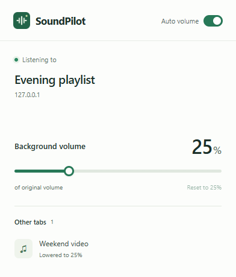

# SoundPilot

[](https://github.com/spark142857142857/soundpilot/actions/workflows/check.yml)
[](LICENSE)

[English](README.md) | 한국어

음악이나 영상을 새로 재생하면 다른 탭의 볼륨을 낮추고, 재생이 끝나면 원래 볼륨으로 복구하는 Chrome 확장 프로그램입니다. 순수 JavaScript로 작성되었으며 런타임 의존성이 없습니다.

<p align="center">
  
</p>

## 주요 기능

- **자동 우선순위.** 가장 최근에 직접 재생한 미디어가 우선합니다. 음악과 영상에 같은 규칙을 적용합니다.
- **배경 볼륨 조절.** 다른 플레이어의 볼륨을 기본적으로 원래 볼륨의 25%로 낮추며, 0–100% 사이에서 조절할 수 있습니다.
- **자동 복구.** 우선 재생 중인 소스를 일시정지하거나 종료하거나 탭을 닫으면, 계속 재생 중인 소스 중 가장 최근에 선택한 소스의 볼륨을 복구합니다. 일시정지된 미디어를 다시 재생하지 않습니다.
- **사이트 공통 적용.** HTTP/HTTPS 사이트에서 접근 가능한 HTML 오디오·영상, 허용된 프레임, 탐지한 Shadow DOM 플레이어에 적용합니다. [호환성](#호환성)을 확인하세요.
- **툴바 팝업.** 영어 팝업에서 설정을 바꾸고 활성 탭을 확인합니다. 팝업을 닫아도 자동 조절은 계속 동작합니다.
- **로컬 동작.** 계정, API 키, 백엔드, 사용 분석, 오디오 녹음이 없습니다.

## 설치

**Google Chrome 120 이상**이 필요합니다. 아직 Chrome 웹 스토어에 게시되지 않았으므로 소스에서 설치합니다. Node.js는 개발할 때만 필요합니다.

```sh
git clone https://github.com/spark142857142857/soundpilot.git
```

[소스 ZIP을 다운로드](https://github.com/spark142857142857/soundpilot/archive/refs/heads/main.zip)하고 압축을 풀어도 됩니다.

1. `chrome://extensions`를 열고 **개발자 모드**를 켭니다.
2. **압축해제된 확장 프로그램을 로드합니다**를 눌러 저장소 안의 **extension** 폴더를 선택합니다. `manifest.json`이 들어 있는 폴더입니다.
3. Chrome 확장 프로그램 메뉴에서 SoundPilot을 열거나 툴바에 고정합니다.

이미 열려 있는 웹 탭도 Chrome에서 허용하는 범위 안에서 연결됩니다. 연결되지 않으면 사이트 접근 권한을 확인하고 페이지를 새로고침하세요. 시크릿 모드에서는 Chrome에서 별도로 접근을 허용해야 합니다.

업데이트, 확장 프로그램 새로고침, 제거 전에 **Auto volume**을 꺼서 조절된 볼륨을 복구하세요. 업데이트 후에는 확장 프로그램과 미디어 페이지를 새로고침하세요.

## 사용법

1. 한 탭에서 음악을 재생합니다.
2. 다른 탭에서 영상을 재생하면 음악이 **원래 볼륨의 25%**로 줄어듭니다.
3. 영상을 일시정지하거나 탭을 닫으면, 계속 재생 중인 음악이 원래 볼륨으로 돌아옵니다.

반대로 영상을 보다가 음악을 재생하면 영상이 배경 소스가 됩니다. 탭을 전환하는 것만으로는 우선순위가 바뀌지 않습니다.

확장 아이콘을 눌러 **Background volume**을 0–100%로 조절하거나, **Reset to 25%**로 기본값을 복구하거나, **Auto volume**을 켜고 끌 수 있습니다. 설정은 로컬에 저장됩니다. 인식된 수동 볼륨 변경은 현재 재생이 겹치는 동안 우선 적용하며, 조절을 거부하는 플레이어와 반복적으로 충돌하면 자동 조절을 멈춥니다.

## 문서

- [제품 범위](docs/PRD.md) — 동작 규칙, 구조, 개선 계획. 영어 문서입니다.
- [검증 범위](docs/TESTING.md) — 테스트한 시나리오, 실행 명령, 남은 검증 항목. 영어 문서입니다.
- [개인정보와 권한](docs/PRIVACY.md) — 로컬 데이터 처리와 권한 설명. 영어 문서입니다.

## 호환성

SoundPilot은 웹페이지에서 접근 가능한 미디어 요소의 볼륨을 조절합니다. 시스템 전체 오디오를 제어하지 않으며, 제어할 수 없는 플레이어도 있습니다.

- DOM에 연결되지 않은 오디오, 독립적인 Web Audio 출력, Chrome 제한 페이지, 접근할 수 없는 프레임은 공통 제어 경로 밖에 있습니다.
- 직접 재생 여부는 최근 페이지 입력을 바탕으로 추정합니다. 광고, 미리보기, 자동 다음 곡, OS 미디어 키는 다르게 동작할 수 있습니다.
- 배경 볼륨 비율은 미디어 요소의 원래 볼륨을 기준으로 계산합니다. 사이트에 표시되는 슬라이더는 다른 눈금을 사용할 수 있습니다.
- 볼륨은 즉시 바뀌며 페이드는 아직 지원하지 않습니다. 복잡하거나 지연된 플레이어 교체는 추가 검증이 필요합니다.

공개 YouTube 영상과 로컬 브라우저 시나리오를 테스트했습니다. 이전 프로토타입은 로그인된 YouTube Music에서도 검증했지만, 현재 버전의 전체 동작을 해당 환경에서 검증한 것은 아닙니다. 치지직과 임의의 커뮤니티 플레이어는 사이트별 전체 검증을 완료하지 않았습니다. 자세한 내용은 [테스트 보고서](docs/TESTING.md)를 확인하세요.

## 개인정보와 권한

미디어 상태와 탭 정보는 로컬에서 처리합니다. 설정은 확장 프로그램의 로컬 저장소에 저장하고, 임시 세션 저장소를 사용해 서비스 워커 재시작 후 현재 탭 상태를 복구합니다.

| 권한 | 용도 |
| --- | --- |
| HTTP/HTTPS 호스트 접근 | 웹페이지와 허용된 프레임의 미디어 탐지 및 볼륨 조절 |
| `tabs` | 우선순위와 팝업 상태에 필요한 탭 제목, 소리·음소거 상태, 탭 생명주기 확인 |
| `scripting` | 설치하거나 활성화할 때 이미 열려 있는 웹페이지 연결 |
| `storage` | 설정 저장과 서비스 워커 재시작 후 상태 복구 |

## 개발

JavaScript, HTML, CSS를 사용하며 별도 빌드 단계가 없습니다. 검사를 실행하려면 **Node.js 22 이상**이 필요합니다.

```sh
cd soundpilot
npm ci
npm run check
npm test
```

브라우저 테스트에는 설치된 Google Chrome이 필요합니다. Playwright가 별도의 임시 프로필에서 테스트를 실행합니다.

```sh
npm run test:browser
npm run test:transitions
npm run test:youtube
```

YouTube 테스트에는 네트워크 연결이 필요합니다. `SOUNDPILOT_CHROME`으로 Chrome 실행 파일을 지정하거나 `SOUNDPILOT_PLAYWRIGHT`로 다른 Playwright 모듈을 사용할 수 있습니다. 브라우저 테스트는 Windows의 Chrome 156에서 검증했습니다. CI에서는 정적 검사와 단위 테스트를 실행합니다.

**Windows**에서는 `npm run package`로 업로드용 ZIP을 생성합니다. ZIP에는 `extension/`의 내용이 들어가며 최상위에 `manifest.json`이 위치합니다. 생성된 패키지, 로컬 연구 자료, 테스트 출력은 Git에서 제외합니다. 위 스크린샷은 통제된 테스트 페이지를 사용했습니다.

## 기여

버그 제보와 PR을 환영합니다. 재생 관련 문제를 제보할 때는 사이트, Chrome 버전, 재생 순서, 재현 절차를 함께 적어주세요. 코드 변경을 제출하기 전에 `npm run check`와 `npm test`를 실행하고, 재생 동작을 바꿨다면 관련 브라우저 테스트도 실행하세요.

## 라이선스

SoundPilot은 [MIT 라이선스](LICENSE)로 배포됩니다.
